  
  
  
  

  
  
  
  
  
  

## GitHub at a glance

<picture>
  <source media="(prefers-color-scheme: dark)" srcset="https://github-readme-stats.vercel.app/api?username=shivamkumar0097&show_icons=true&hide_border=true&include_all_commits=true&count_private=true&theme=github_dark">
  
</picture>
<picture>
  <source media="(prefers-color-scheme: dark)" srcset="https://streak-stats.demolab.com?user=shivamkumar0097&hide_border=true&theme=github-dark">
  
</picture>

## Featured work

| Project | What it does | Live |
| :-- | :-- | :--: |
| **PDF Studio** | 16 private, in-browser PDF tools | [Visit](https://pdfstudio-free.netlify.app) |
| **Campus Store** | Campus essentials store with cart & checkout | [Visit](https://campus-storee.netlify.app) |
| **Weather Check** | Live weather app powered by a real API | [Visit](https://today-weathercheck.netlify.app) |

## Contributions

  <picture>
    <source media="(prefers-color-scheme: dark)" srcset="https://raw.githubusercontent.com/shivamkumar0097/shivamkumar0097/output/snake-dark.svg">
    
  </picture>

  

Open to freelance & full-time frontend roles · <a href="mailto:shivamkr8135@gmail.com">shivamkr8135@gmail.com</a>

