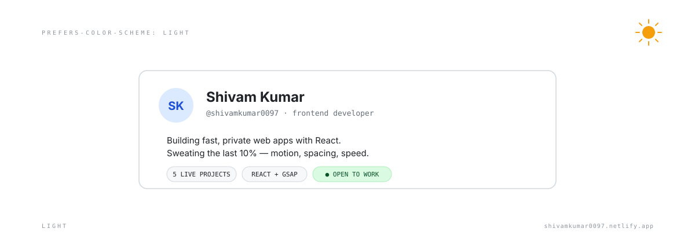

<picture>
  <source media="(prefers-color-scheme: dark)" srcset="./assets/profile-dark.svg">
  <source media="(prefers-color-scheme: light)" srcset="./assets/profile-light.svg">
  
</picture>

  <a href="https://shivamkumar0097.netlify.app">Portfolio</a>
  &nbsp;·&nbsp;
  <a href="https://github.com/shivamkumar0097?tab=repositories">GitHub</a>
  &nbsp;·&nbsp;
  <a href="https://www.linkedin.com/in/shivamkumar0097">LinkedIn</a>
  &nbsp;·&nbsp;
  <a href="mailto:shivamkr8135@gmail.com">Email</a>

